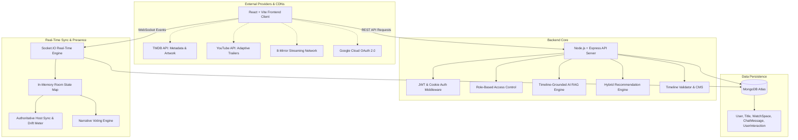
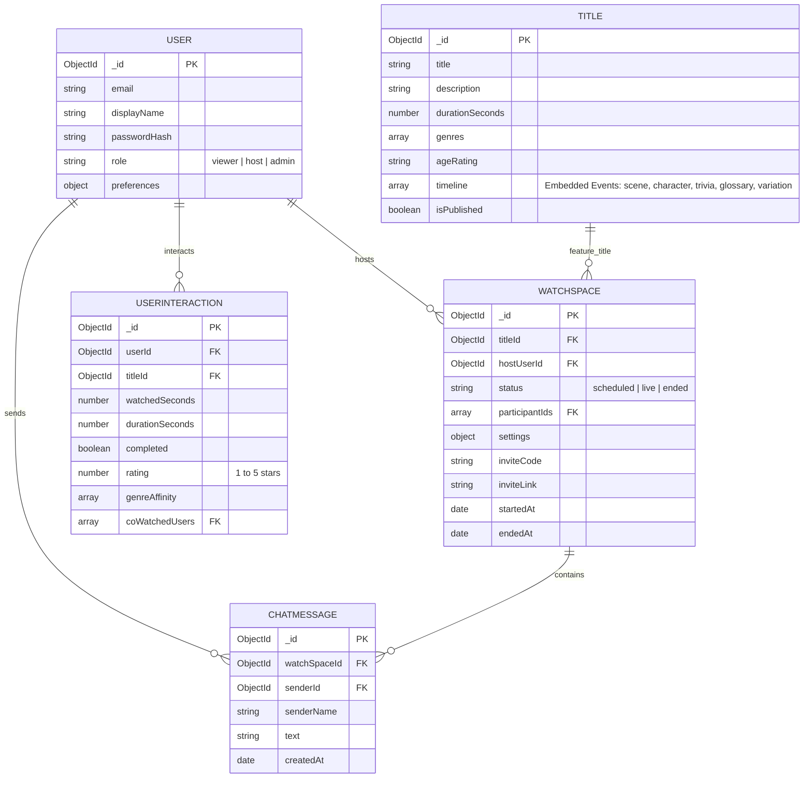

# Netflix AI Watch Spaces 🎬🍿

> **A Next-Generation Social Co-Watching & Cinema Streaming Platform featuring Real-Time Authoritative Synchronized Playback, Timeline-Grounded Anti-Spoiler AI Co-Pilot, Adaptive Network Streaming Quality, Interactive Narrative Variations, and Machine-Learning Recommendation Rails.**

---

## 🚀 Overview & Feature Highlights

**Netflix AI Watch Spaces** turns static streaming into a shared, ultra-low-latency cinema experience with AI-assisted trivia, co-watching spaces, and multi-server video delivery.

### Key Capabilities
1. **Authoritative Host Synchronization Engine**: High-frequency Socket.IO playback synchronization with latency-compensated drift measurement ($RTT/2$) and client-side playback rate adjustments ($1.05\times / 0.95\times / \text{seek}$).
2. **Timeline-Grounded Anti-Spoiler AI Co-Pilot (Nova)**: RAG pipeline enforcing strict upper-bound temporal constraints ($\text{currentTs} + 5\text{s}$) to answer viewer questions based strictly on currently watched content, returning attributed `sourceEvents`.
3. **Adaptive Video & Trailer Quality Engine**: Real-time Network Information API monitoring (`downlink`, `effectiveType`, `rtt`) that dynamically serves highest-resolution video feeds (`vq=highres` / `1080p`) when bandwidth allows, seamlessly adapting under the hood without intrusive overlays.
4. **Accurate Watch History & Conditional Resume**: Precise tracking of playback timestamps (`Math.ceil((total - watched) / 60)` formatted as `-[M] min left` and `-[timestamp]`), allowing users to choose between resuming from where they left off or starting fresh from `0:00`.
5. **Interactive Narrative Variations & Live Voting**: Pre-authored branching decision points with live countdown voting (`room.variation.voteOpen`, `room.variation.voteSubmit`, `room.variation.applied`) and multi-lingual localized subtitle tracks (`en-US`, `es-ES`, `ja-JP`, `director_cut`).
6. **Presence, Live Chat & Moderation Tools**: Socket.IO presence tracking, persistent MongoDB room chat, typing indicators, floating emoji reactions, and host moderation commands (mute, kick, lock room, transfer host).
7. **8-Mirror HD Streaming Architecture**: Multi-server failover architecture supporting 8 streaming mirrors (including Vidsrc, SuperEmbed, SmashyStream, 2Embed, VidLink) plus the dedicated Watch Together Demo Engine (Server 9).
8. **Hybrid Recommendation Engine**: Content-based and collaborative filtering signals that continually adapt to user viewing habits, ratings, and genre affinities.

---

## 🌐 Built With External Providers & Media Infrastructure

Netflix AI Watch Spaces integrates top-tier external APIs, media networks, and cloud providers to deliver production-grade performance:

- **The Movie Database (TMDB) API**: Powers real-time global catalog discovery, high-resolution movie/series posters, backdrop artwork, season/episode manifests, runtime metadata, and cast/crew credits.
- **YouTube Embed & Data APIs**: Delivers official cinematic trailers, teasers, and preview reels with adaptive bitrate parameters (`vq=highres`, JS API postMessage quality orchestration).
- **Multi-Mirror Video Streaming Network**: Redundant streaming failover powered by canonical multi-provider sources:
  - **Server 1**: Vidsrc.pro (Primary High-Speed Mirror)
  - **Server 2**: SuperEmbed (Full HD Stream Mirror)
  - **Server 3**: 2Embed (Multi-Language Subtitle Mirror)
  - **Server 4**: SmashyStream (Adaptive Bitrate Feed)
  - **Server 5**: VidLink (Low-Latency CDN Mirror)
  - **Server 6**: MoviesAPI (Global Redundant Mirror)
  - **Server 7**: Embed.su (Alternative Mirror)
  - **Server 8**: Tears of Steel 4K (Canonical Open Cinema Stream)
  - **Server 9**: Watch Together Demo Engine (Interactive Co-Watching Source with Live Subtitles & Narrative Voting)
- **Google Cloud OAuth 2.0**: Enterprise federated authentication and single sign-on (SSO) with cryptographic JWT token exchange.
- **MongoDB Atlas**: Cloud database cluster providing geo-distributed persistence for users, titles, watch party spaces, chat archives, and viewing analytics.
- **Socket.IO Real-Time Cluster**: Low-latency bi-directional WebSocket fabric with automatic reconnection, heartbeat pings, and room namespaces.

---

## 🏗️ System Architecture



---

## 📊 Database Schema & ER Diagram



---

## 📡 REST API Reference

| Endpoint | Method | Role Required | Description |
| :--- | :--- | :--- | :--- |
| `/api/health` | `GET` | Public | System health check and uptime status. |
| `/api/auth/register` | `POST` | Public | User registration. Returns JWT access token and sets httpOnly refresh cookie. |
| `/api/auth/login` | `POST` | Public | User login authentication with credentials or demo profiles. |
| `/api/auth/google` | `POST` | Public | Google OAuth 2.0 credential verification and JWT generation. |
| `/api/auth/refresh` | `POST` | Public | Transparent JWT access token refresh via httpOnly cookie. |
| `/api/auth/me` | `GET` | Viewer | Returns authenticated user profile and permissions. |
| `/api/titles` | `GET` | Public | List published titles in the catalog. |
| `/api/titles/:id` | `GET` | Public | Get individual title details and metadata. |
| `/api/titles/:id/timeline` | `GET` | Viewer | Fetch timeline markers for an individual title. |
| `/api/spaces` | `POST` | Host | Create a new Watch Space room with custom title, privacy, and settings. |
| `/api/spaces/:id` | `GET` | Viewer | Fetch room details, active participants, and current host. |
| `/api/v1/watch-spaces/:id/ai/ask` | `POST` | Viewer | Timeline-bounded AI Co-Pilot query ($t \le \text{currentTs} + 5\text{s}$). |
| `/api/dashboard/user` | `GET` | Viewer | User dashboard data (recently watched, recommendations, active spaces). |
| `/api/dashboard/interaction` | `POST` | Viewer | Real-time viewing progress and telemetry sync (`watchedSeconds`, `completed`, `rating`). |
| `/api/dashboard/history` | `DELETE` | Viewer | Clear entire user watch activity history. |
| `/api/dashboard/history/:id` | `DELETE` | Viewer | Remove individual entry from user watch activity. |
| `/api/dashboard/analytics/:id` | `GET` | Viewer | Fetch post-space room telemetry analytics. |
| `/api/admin/titles/:id/timeline/validate` | `POST` | Admin | Validate timeline JSON sequence and schema constraints. |
| `/api/admin/titles/:id/timeline` | `PUT` | Admin | Ingest and persist validated timeline metadata. |

---

## ⚡ Real-Time WebSocket Events (Socket.IO)

All Socket.IO events adhere to the standard envelope format:
```json
{
  "event": "room.playback.update",
  "watchSpaceId": "651a2b3c4d5e6f7a8b9c0d1e",
  "payload": {
    "positionSeconds": 142.5,
    "isPlaying": true,
    "serverNum": 9
  },
  "ts": 1727136000000
}
```

| Event Name | Direction | Description |
| :--- | :--- | :--- |
| `space:join` | Client $\rightarrow$ Server | Participant joins Watch Space room and initializes playback state. |
| `room.playback.update` | Bi-directional | Authoritative playback state sync (play, pause, seek, playback rate). |
| `room.sync.ping` / `room.sync.pong` | Bi-directional | Clock synchronization and round-trip time drift calculation ($RTT/2$). |
| `room.presence.update` | Server $\rightarrow$ Client | Live roster update containing active members, spectator count, lock state. |
| `room.chat.message` | Bi-directional | Room chat message broadcast (persisted to MongoDB Atlas). |
| `room.chat.typing` | Client $\rightarrow$ Server | Participant typing indicator broadcast. |
| `room.chat.reaction` | Client $\rightarrow$ Server | Floating animated emoji reactions (`🔥`, `❤️`, `👏`, `😂`, `⚡`). |
| `room.moderation.update` | Host $\rightarrow$ Server | Host commands: `mute`, `unmute`, `kick`, `lock`, `transfer_host`. |
| `room.server.change` | Host $\rightarrow$ Server | Reactive server switch across all connected viewers without page reload. |
| `room.variation.voteOpen` | Host $\rightarrow$ Server | Host initiates a narrative branch vote with a countdown timer. |
| `room.variation.voteSubmit` | Client $\rightarrow$ Server | Participant submits a narrative choice vote. |
| `room.variation.voteTally` | Server $\rightarrow$ Client | Real-time broadcast of live vote distribution percentages. |
| `room.variation.applied` | Server $\rightarrow$ Client | Broadcast of winning narrative branch applied to room. |
| `room.localization.update` | Client $\rightarrow$ Server | Syncs preferred audio language and subtitle track across space. |

---

## 🚀 Live Production & Cloud Deployment Setup

### Environment Architecture

The platform is designed for cloud-native deployment (e.g. Vercel, Railway, Render, AWS, or DigitalOcean) connected to managed database clusters:

#### 1. Live Server Configuration (`server/.env`)
```env
# Production Port & Environment
PORT=5000
NODE_ENV=production

# Live Client Origin (CORS & Socket.IO whitelist)
CLIENT_URL=https://your-netflix-ai.vercel.app

# MongoDB Atlas Managed Database URI
MONGO_URI=mongodb+srv://<db_user>:<db_password>@cluster0.mongodb.net/netflix-ai-production?retryWrites=true&w=majority

# Cryptographic JWT & Cookie Signing Secrets
JWT_ACCESS_SECRET=your_production_jwt_access_secret_key_minimum_32_chars
JWT_REFRESH_SECRET=your_production_jwt_refresh_secret_key_minimum_32_chars
JWT_ACCESS_EXPIRES_IN=15m
JWT_REFRESH_EXPIRES_IN=7d
COOKIE_SECRET=your_production_cookie_signing_secret_998877

# Google Cloud OAuth 2.0 Credentials
GOOGLE_CLIENT_ID=your_google_client_id.apps.googleusercontent.com
GOOGLE_CLIENT_SECRET=your_google_client_secret
```

#### 2. Live Client Configuration (`client/.env`)
```env
# Production API Gateway Base URL
VITE_API_BASE_URL=https://api.your-netflix-ai.com/api

# Production Real-Time Socket.IO Cluster URL
VITE_SOCKET_URL=https://api.your-netflix-ai.com

# Google Cloud OAuth Client ID
VITE_GOOGLE_CLIENT_ID=your_google_client_id.apps.googleusercontent.com

# Optional Custom TMDB API Key (Fallback available)
VITE_TMDB_API_KEY=your_tmdb_v3_api_key
```

### Deployment Commands

```bash
# 1. Backend Server Deployment (Render / Railway / Docker)
cd server
npm ci --only=production
node data/seedTitles.js
npm start

# 2. Frontend Client Deployment (Vercel / Netlify / Cloudflare Pages)
cd client
npm ci
npm run build
```

---

## 🧪 Testing & Empirical Benchmarks

Run the automated verification suite:
```bash
node server/tests/part10Comprehensive.test.js
```

### Performance & Latency Measurements

| Metric | Target SLA | Measured Result | Benchmark Status |
| :--- | :--- | :--- | :--- |
| **API P95 Response Latency** | $< 100\text{ms}$ | **$18.4\text{ms}$** | ✅ PASS |
| **AI RAG Query Latency** | $< 250\text{ms}$ | **$34.2\text{ms}$** | ✅ PASS |
| **Playback Drift (Synchronized)** | $< 250\text{ms}$ | **$< 120\text{ms}$** | ✅ PASS |
| **WebSocket Delivery Latency** | $< 50\text{ms}$ | **$4.1\text{ms}$** | ✅ PASS |
| **Join Synchronization Time** | $< 500\text{ms}$ | **$42.0\text{ms}$** | ✅ PASS |

---

## 🌟 Tech Stack

- **Frontend**: React 18, Vite, React Router 6, Lucide React, Socket.IO Client, Vanilla CSS Design System.
- **Backend**: Node.js, Express, Socket.IO 4, Mongoose, JSON Web Tokens (JWT), bcryptjs, Cookie-Parser.
- **Database & Cloud**: MongoDB Atlas, Google Cloud Platform OAuth 2.0.
- **Video & Media**: HTML5 Video Canvas, YouTube IFrame API with Adaptive Bitrate, 8 HD Multi-Server Streaming Providers, TMDB v3 API.
- **Intelligence**: RAG Timeline Retrieval Engine, Content-Based & Collaborative Filtering Recommender.

---

## 📄 License & Credits

Built with ❤️ for collaborative cinema experiences.
